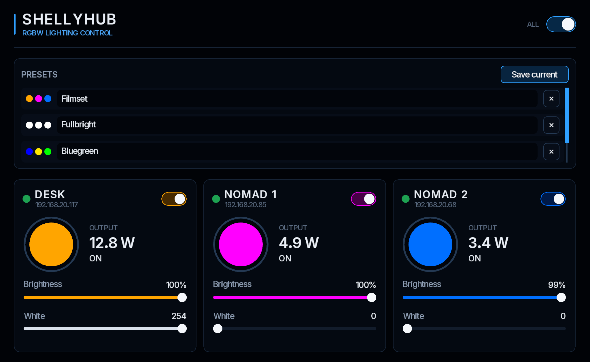
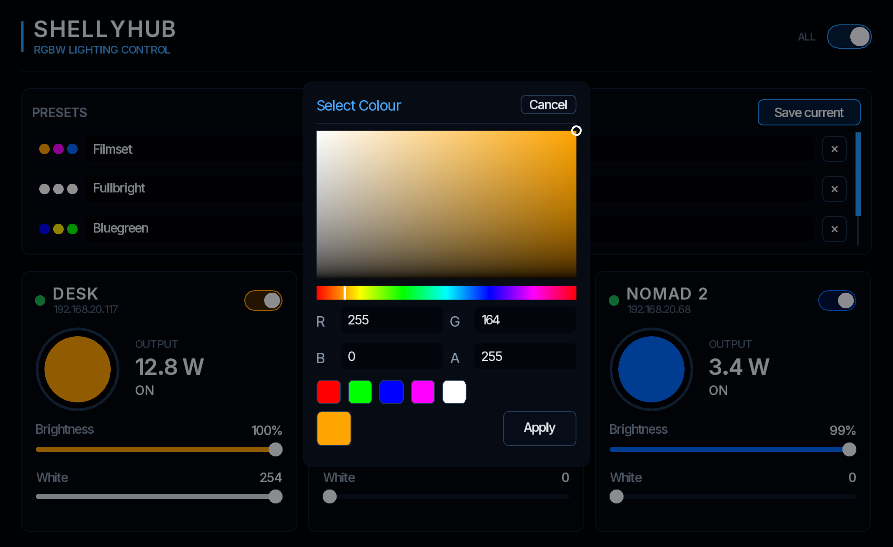

# ShellyHub

Native [Koya](https://developer.koya-ui.com) desktop app for controlling [Shelly Plus RGBW PM](https://shelly-api-docs.shelly.cloud/gen2/Devices/Gen2/ShellyPlusRGBWPM/) lights on the local network.

Each light gets its own panel: on/off, colour, brightness, white channel, live power, and online state. A header switch turns every light on or off together. Presets store the whole set and apply it in one click.





## Requirements

- Linux with Wayland and a Vulkan 1.3 capable GPU supported by Koya
- [Koya](https://developer.koya-ui.com/install/) 0.7.1 or newer
- Matching Helix plugins `libhx-http.so`, `libhx-ws.so`, and `libhx-process.so` (`helix-plugin-http`, `helix-plugin-ws`, and `helix-plugin-process` packages)

Lights must be reachable on the LAN with Gen2 RPC enabled (the default on Plus RGBW PM). ShellyHub does not use the Shelly cloud.

## Configure

Edit the device list in [`app/config.js`](app/config.js). Panel titles come from the device (`Sys.GetConfig` / `RGBW.GetConfig`), then the Shelly device id.

```js
export const DEVICES = [
  {id: 'light1', ip: '192.168.1.101'},
  {id: 'light2', ip: '192.168.1.102'},
  {id: 'light3', ip: '192.168.1.103'},
];
```

`id` is the local key used in presets. `ip` is the address ShellyHub opens. The window lays the panels out in a row, so a handful of lights fits the default size (`1024×628` in the same file).

## Run

```bash
./scripts/run.sh
```

The launcher mounts the app and starts [`app/shellyhub.js`](app/shellyhub.js) (Koya’s default entry is `/rom/index.js`, so the script is named to avoid that clash).

It looks for Koya 0.7.1 or newer on `PATH`, then common install locations, and a local Helix checkout. An explicit `KOYA_BIN` takes priority and fails immediately if it is incompatible. Assets and plugins are resolved beside the chosen runtime or in its installation prefix. Point it at a specific build when needed:

```bash
KOYA_BIN=/path/to/koya \
KOYA_ASSETS=/path/to/koya-base/assets \
SHELLYHUB_PLUGINS=/path/to/helix-plugin \
  ./scripts/run.sh
```

| Variable | Meaning |
| --- | --- |
| `KOYA_BIN` | Koya binary |
| `KOYA_ASSETS` | Matching runtime assets directory (shaders, fonts, std) |
| `SHELLYHUB_PLUGINS` | Directory that contains the three matching `libhx-*.so` plugins |

Keep the runtime, assets (including `std/koya-ui.js` and `std/koya-controls.js`), and native plugins from the same release. Koya’s [input migration](https://developer.koya-ui.com/migration-0-5-0-to-0-6-0/) removed the old mouse callbacks; ShellyHub uses virtual activation, hover, press capture, and scroll events.

## Verify

With Node.js 22 or newer and Bash installed:

```bash
node --experimental-vm-modules tests/ui-input.test.mjs
bash tests/koya-env.test.sh
```

## Controls

- **All** — header toggle. If any light is on, it turns them all off; otherwise it turns them all on.
- **Per light** — on/off, colour swatch (HSV picker; Apply sends `RGBW.Set`), brightness, white channel, power in watts, and whether the host is online.
- **Presets** — **Save current** snapshots every light. Click a row to apply it, click the name to rename it, or remove it. The list shows three rows and scrolls.

Presets are stored at `~/.config/shellyhub/presets.json`.

## Transport

Each light keeps an inbound WebSocket to `ws://<ip>/rpc` for commands and live `NotifyStatus` updates. If the socket is down or a call times out, the same RPC is sent over HTTP. Hosts that are offline are probed slowly over HTTP so a dead address does not stall the single HTTP worker.

## Font

The UI uses [Inter](https://github.com/rsms/inter), licensed under the SIL Open Font License. See [`app/fonts/OFL-Inter.txt`](app/fonts/OFL-Inter.txt).
